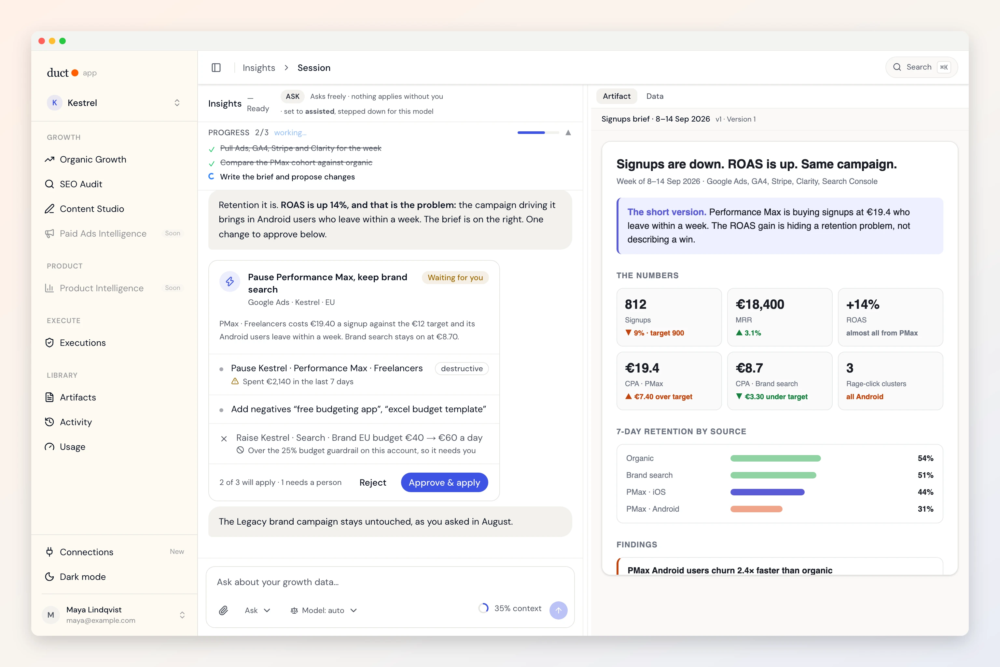
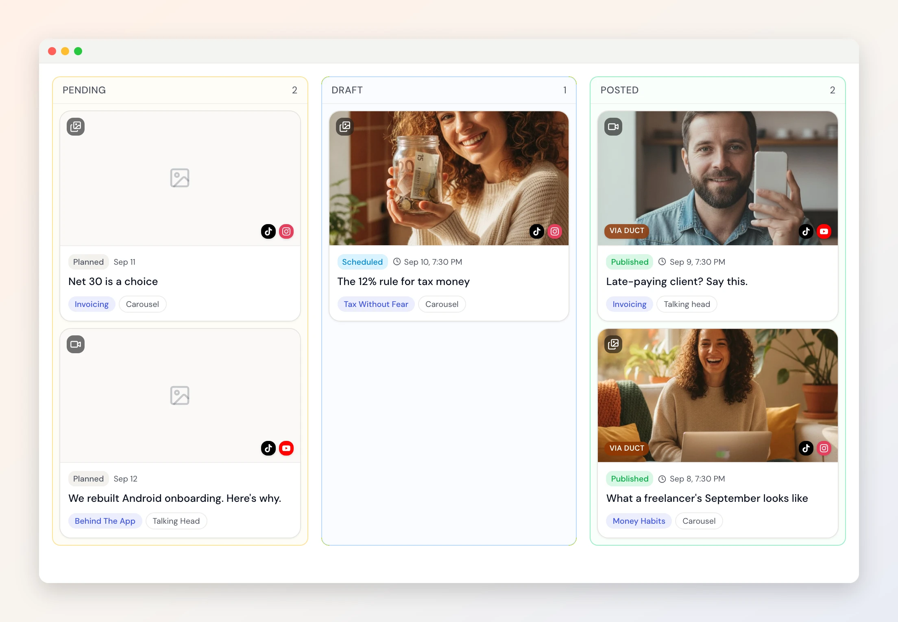
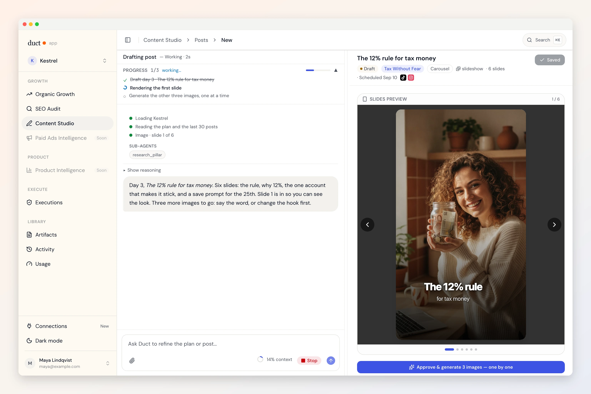
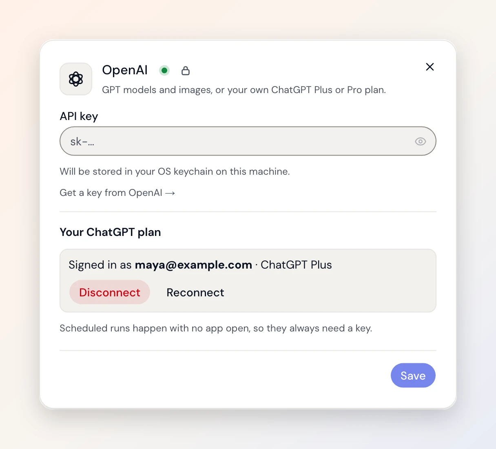
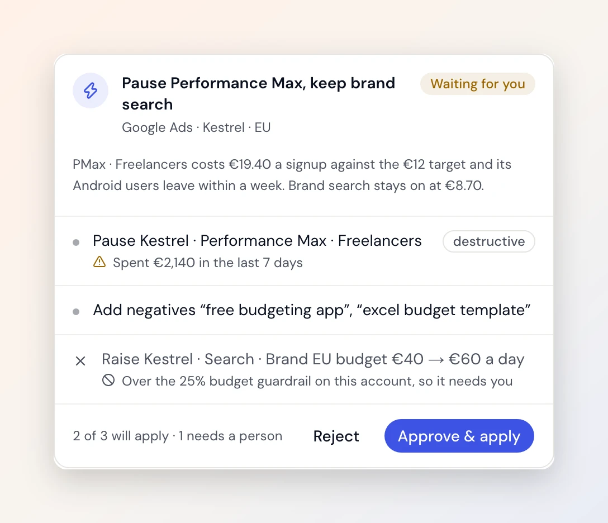
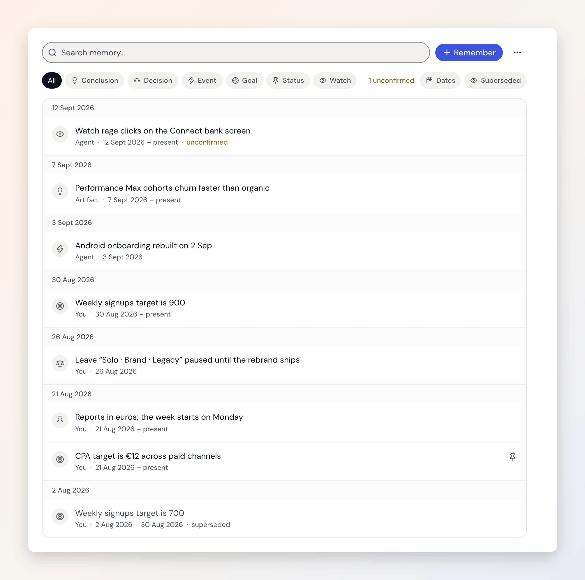
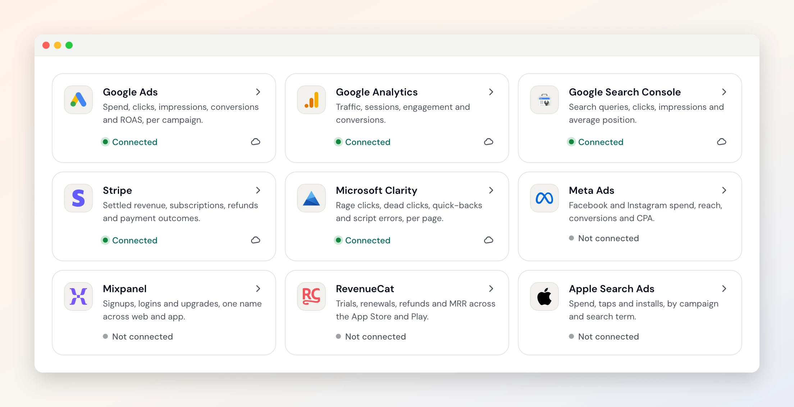

<p align="center">
  
</p>

# Duct

<p align="center"><a href="README.md">English</a> · <b>Español</b> · <a href="README.zh-CN.md">简体中文</a></p>

> Esta traducción es un primer borrador hecho a máquina. ¿Algo suena raro? Abre un PR o cuéntanoslo en un [issue](https://github.com/5hirish/duct/issues): es una muy buena primera contribución.

**Agente de marketing con IA de código abierto: un analista de crecimiento con cada acceso.**

Duct es para equipos de producto y de crecimiento. Conecta Google Ads, GA4,
Search Console, Mixpanel, Stripe y siete herramientas más, las lee todas a la
vez como lo haría un analista con todos los accesos, recuerda lo que aprende
sobre tu negocio y, con tu aprobación, cambia cosas en esas herramientas por
ti. La herramienta de aprobar no existe en la lista que el modelo puede llamar:
el botón lo pulsas tú.

[](LICENSE)
[](.github/workflows/backend.yml)
[](.github/workflows/app.yml)
[](https://getduct.ai/es/download)

**[⬇️ Descarga la app de escritorio](https://getduct.ai/es/download)** y Duct
ejecuta el servicio por ti; tus claves de modelo nunca salen de tu equipo.
¿Prefieres ejecutar cada parte tú mismo? [Alójalo tú mismo](#-alójalo-tú-mismo).
El mismo código, MIT en los dos casos.

Gratis durante la beta · Sin tarjeta de crédito · Unos 10 minutos para conectar tus herramientas

| Antes de instalar | Respuesta directa |
|---|---|
| **¿Dónde se guardan mis claves?** | Claves de modelo: en el llavero de tu sistema, nunca en nuestros servidores. Conexiones a herramientas: cifradas en reposo, un proyecto cada vez, y en tu propio disco si lo alojas tú. |
| **¿Qué puede hacer el agente sin mí?** | Leer, comparar y proponer. Por defecto, nada cambia en tus cuentas hasta que pulsas Aplicar. [Cómo se garantiza](#-hace-cambios-tú-los-apruebas). |
| **¿Cuánto cuesta usarlo?** | Duct es gratis durante la beta. El modelo es tuyo: tu propia clave de API, o tu plan de ChatGPT en la app de escritorio. |
| **¿Puedo ejecutarlo todo yo?** | Sí. [Alójalo tú mismo](#-alójalo-tú-mismo): SQLite en tu disco, sin cuenta, sin que nada salga de tu equipo. |
| **¿Y si Duct desaparece?** | Es MIT. La versión autoalojada es el mismo código y no necesita nada de nosotros. |

---

## 🤖 Tres agentes, y vienen más

**📊 Hallazgos (Insights).** Pregunta "¿por qué bajaron los registros la semana
pasada?" y recibe una respuesta que lee Google Ads, GA4 y Stripe a la vez, no
una por una. El tipo de cosa que encuentra: *el ROAS sube un 14 %, pero la
retención a 7 días en Android cae 2,4 veces. Estás pagando por captar usuarios
que se van.* Se detiene a preguntarte cuando necesita una decisión, un
subagente de verificación vuelve a comprobar cada número antes de que te
llegue, y el informe que escribe se guarda, se versiona y cita sus fuentes.

**🌱 Auditoría SEO.** Pega una URL y Duct rastrea el sitio, lee las señales
técnicas y de contenido, y te devuelve un informe con las prioridades
ordenadas. Es la puerta de entrada gratuita en [getduct.ai](https://getduct.ai/es/):
no necesitas cuenta para ejecutar una.

**🎬 Content Studio.** Un plan en un tablero, una publicación por tarjeta,
diapositivas e imágenes generadas para cada una, y un clic para publicar en
TikTok, Instagram, LinkedIn, YouTube, Threads, X, Facebook, Pinterest y
Bluesky. Los resultados vuelven a la tarjeta, así que el siguiente plan
aprende del anterior.

<p align="center">
  
  
</p>

**Para quién es hoy:** PMs y equipos de crecimiento, equipos de SEO y
contenido, y especialistas en marketing de rendimiento que persiguen huecos de
atribución, cambios de presupuesto y fatiga creativa.

**🚧 Lo próximo:** Ventas y RevOps (riesgo en el pipeline y señales de
conversión a partir del CRM, las llamadas y el uso del producto), E-commerce y
DTC (puntos ciegos entre LTV y ROAS en Meta Ads, Stripe y RevenueCat) y
Customer Success (cuentas en riesgo a partir del NPS, el uso y las señales de
soporte). Síguelo en [Issues](https://github.com/5hirish/duct/issues) y en
[getduct.ai](https://getduct.ai/es/).

## 🧩 Para tu agente de programación

Pregunta a Claude Code, Codex o Cursor "¿está mi sitio listo para lanzarse?" y
leerá tus páginas en vivo y el repositorio que hay detrás, comprobará si lo que
promete la página coincide con lo que hace el código, puntuará el lanzamiento
sobre 100 y te dará tres arreglos ordenados, cada uno como un diff que solo
aplica cuando dices que sí. Sin cuenta de Duct, sin enviarnos nada.

| Agente | Instalación |
|---|---|
| Claude Code | `/plugin marketplace add 5hirish/duct` y luego `/plugin install duct@duct` |
| Codex | `codex plugin marketplace add 5hirish/duct` y luego instala Duct desde `/plugins` |
| Cursor, Copilot, OpenCode y el resto | `npx skills add 5hirish/duct` |

Qué comprueba, y una ejecución real sobre nuestro propio sitio: [getduct.ai/skills](https://getduct.ai/es/skills).

## 🔑 Usa tu suscripción de ChatGPT

Inicia sesión con tu propio plan de ChatGPT en la app de escritorio y Duct
funciona con él. Sin clave de API y sin una segunda factura. O trae claves de
Anthropic, OpenAI, Gemini, xAI o cualquier modelo de OpenRouter, y asigna tres
niveles, Heavy, Standard y Light, para que un análisis profundo y un resumen
barato no paguen lo mismo. Si llegas a un límite de uso, Duct baja un nivel en
lugar de detenerse.

<p align="center">
  
</p>

## ✅ Hace cambios. Tú los apruebas.

Un agente puede proponer un cambio y mostrarte una vista previa; quien lo
aplica es una persona. Pausar una campaña, añadir palabras clave negativas,
fijar un presupuesto o una puja, crear un evento clave o una audiencia en GA4,
publicar una versión de Tag Manager, anotar Mixpanel. Cada conjunto de cambios
se previsualiza, se comprueba contra los límites que tú fijas, se aplica solo
después de tu aprobación y se puede revertir. El agente puede proponer e
inspeccionar. No puede aprobar ni aplicar. Esa decisión vive en un código que
el modelo nunca ve, y hay un test que lo mantiene así.

<p align="center">
  
</p>

## 🧠 Recuerda

Duct guarda una memoria de tu negocio, tus proyectos y el trabajo que ha hecho:
el objetivo de CPA, la campaña que le dijiste que ignorara (y que fuiste tú
quien lo dijo), el hallazgo del informe del mes pasado. Cada dato sabe cuándo
era cierto y qué lo sustituyó, así que una respuesta puede explicar por qué
cree algo. Puedes leer toda la línea de tiempo, corregirla, fijar lo que
importa, pausarla o reiniciarla.

<p align="center">
  
</p>

## 🔌 Conectores, y más cada mes

Google Ads · Google Analytics 4 · Search Console · Tag Manager · Meta Ads ·
Apple Search Ads · OpenAI Ads · Mixpanel · Microsoft Clarity · GrowthBook ·
Stripe · RevenueCat · GitHub, con HubSpot a continuación y nuevos conectores a
medida que los agentes los necesitan. Qué lee y qué puede cambiar cada uno:
[getduct.ai/integrations](https://getduct.ai/es/integrations/).

Google se conecta con OAuth, en solo lectura salvo que concedas más; el resto
usa una clave que pegas. Las credenciales se cifran en reposo, se limitan a un
proyecto cada vez, y Duct te dice exactamente qué permisos tiene y cuáles le
faltan.

<p align="center">
  
</p>

## 👥 Hecho para equipos

Los proyectos guardan el contexto. Invita a colaboradores, comparte un informe
con ellos mediante un enlace, y cada informe, auditoría y plan se queda en la
biblioteca del proyecto, versionado, para la próxima persona que pregunte.

## 🖥️ La app de escritorio

Nativa en macOS, Windows y Linux. Las claves de modelo viven en el llavero del
sistema, el inicio de sesión se hace en tu propio navegador, las
actualizaciones van firmadas, y te saluda con un mosaico.
**[Descárgala](https://getduct.ai/es/download).**

### 🏠 Alójalo tú mismo

La misma app se puede compilar con el backend dentro: SQLite en tu disco, solo
loopback, sin cuenta, sin que nada salga de tu equipo. O ejecuta el backend en
tu propio servidor:

```bash
git clone https://github.com/5hirish/duct.git && cd duct
make setup
cp backend/.env.example backend/.env.local   # añade la clave de un proveedor de modelos
make serve-backend                            # y luego, en una segunda terminal:
make serve-app
```

[CONTRIBUTING.md](CONTRIBUTING.md) tiene la configuración completa, y
[desktop/README.md](desktop/README.md) explica la versión autoalojada.

## 🧭 Cómo está construido

Python y FastAPI en el backend, Next.js en el navegador, un shell de Tauri en
el escritorio, un solo repositorio. **[docs/architecture.html](docs/architecture.html)**
es el mapa interactivo: ábrelo en un navegador, elige la tarea que vienes a
hacer y te lleva a los archivos. La
[Doctrina de Duct](https://getduct.ai/es/doctrine) es la versión corta de lo que
cree el proyecto, con cada principio enlazado al código que lo hace cumplir.

| Ruta | Qué es | Lee primero |
|---|---|---|
| [`backend/`](backend/) | API, agentes, conectores, base de datos | [`backend/AGENTS.md`](backend/AGENTS.md) |
| [`app/`](app/) | La interfaz del producto | [`app/AGENTS.md`](app/AGENTS.md) |
| [`desktop/`](desktop/) | El shell nativo | [`desktop/AGENTS.md`](desktop/AGENTS.md) |
| [`site/`](site/) | getduct.ai | [`site/AGENTS.md`](site/AGENTS.md) |
| [`docs/`](docs/) | Registros y referencias de ingeniería | [`docs/README.md`](docs/README.md) |

## 🤝 Contribuir

Empieza por [CONTRIBUTING.md](CONTRIBUTING.md). ¿No vas a tocar código?
[CONTRIBUTOR-PLAYBOOK.md](CONTRIBUTOR-PLAYBOOK.md) es para opiniones sobre el
diseño, redacción y propuestas de producto. Todas las personas que ayudan
aparecen en [CONTRIBUTORS.md](CONTRIBUTORS.md). Las contribuciones escritas
con agentes son bienvenidas; la plantilla de PR pregunta dónde ayudó un agente
para que quien revisa sepa dónde mirar. Los problemas de seguridad van a
[SECURITY.md](SECURITY.md), nunca a un issue público.

## 💬 Comunidad

Las preguntas e ideas van en [Discussions](https://github.com/5hirish/duct/discussions),
y los errores y propuestas en [Issues](https://github.com/5hirish/duct/issues).
Duct lo construye [Shirish Kadam](https://github.com/5hirish); más en
[shirishkadam.com](https://shirishkadam.com), [@5hirish](https://x.com/5hirish)
y [Ship with AI](https://youtube.com/@5hirish) en YouTube.

## 📄 Licencia

MIT, consulta [LICENSE](LICENSE). [NOTICE](NOTICE) enumera lo que la licencia
no cubre: la documentación de terceros en `docs/guides/` y las marcas
registradas.

## 🏛️ ¿Por qué "Duct"?

El nombre es latín. *Ductus*: una conducción. Es la misma palabra que se
esconde dentro de *aquaeductus*. Los acueductos de Roma nunca produjeron ni
una gota de agua. La llevaban, solo con la gravedad, desde donde estaba hasta
donde vivía la gente, y algunos lo siguen haciendo dos mil años después sin
una sola pieza móvil. Esa es toda la descripción del puesto. Tus datos ya
existen. Duct es el canal.

Por eso la app te recibe con mosaicos romanos de umbral en lugar de
ilustraciones de robots: un manantial en la puerta de entrada (`FONS`), una
puerta abierta cuando empiezas (`SALVE`), una pila seca con dos palomas
curiosas cuando todavía no hay nada que mostrar (`NIHIL`), un acueducto al que
le falta un arco cuando falla una conexión, el perro guardián de Pompeya
cuando no tienes permiso para entrar (`CAVE·CANEM`), y este, para cuando todo
está al día y el agua corre a caudal pleno:

<p align="center">
  
  <br>
  <sub><em>OTIVM.</em> Ocio. La paloma está dormida. Has llegado al final del README, así que puede que tú también.</sub>
</p>
