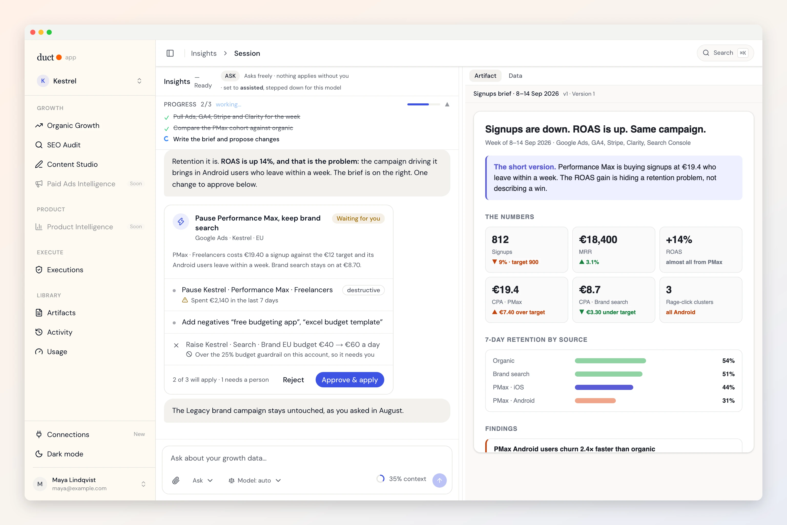
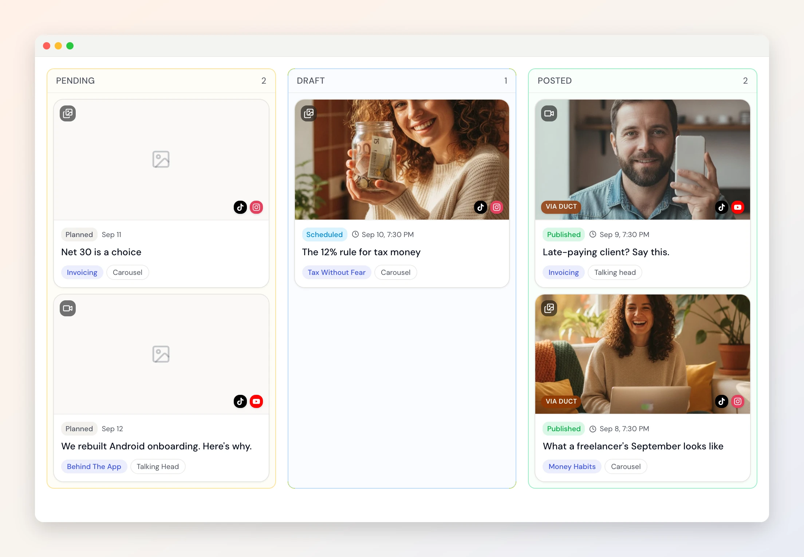
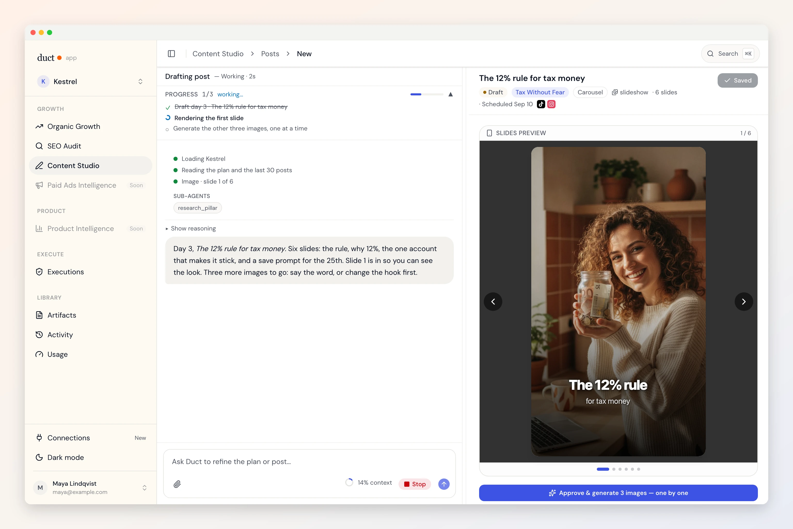
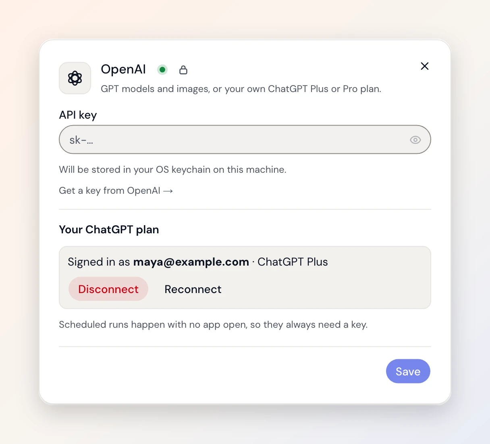
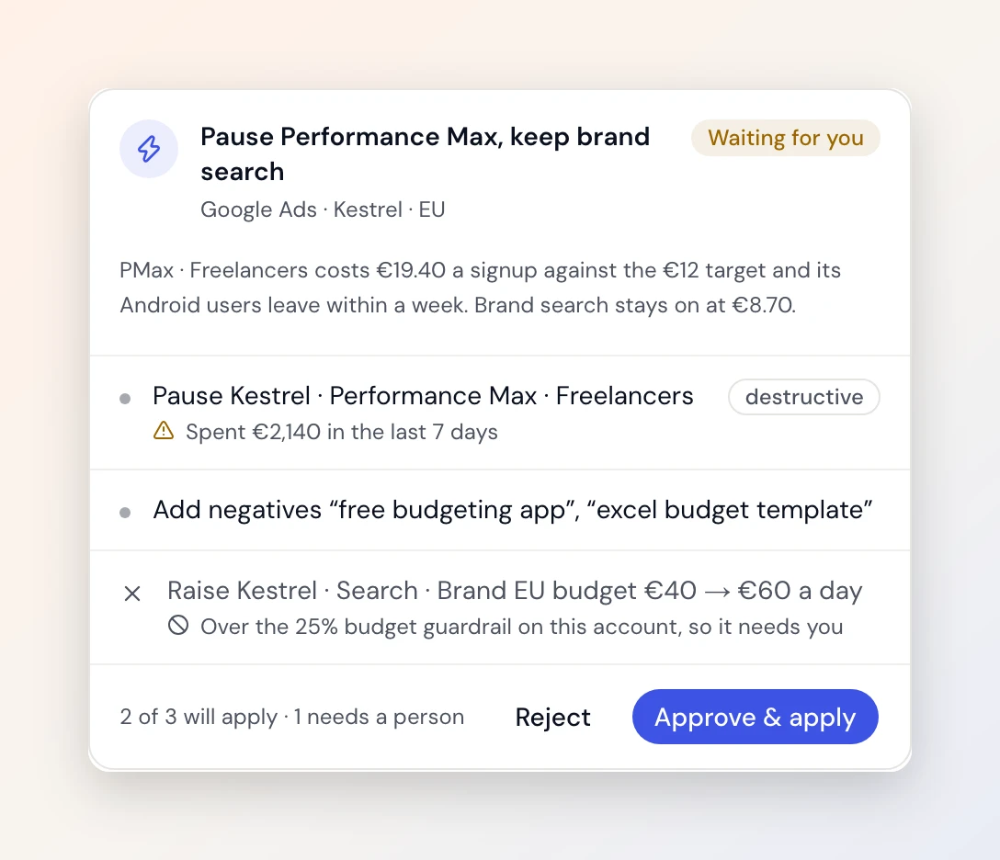
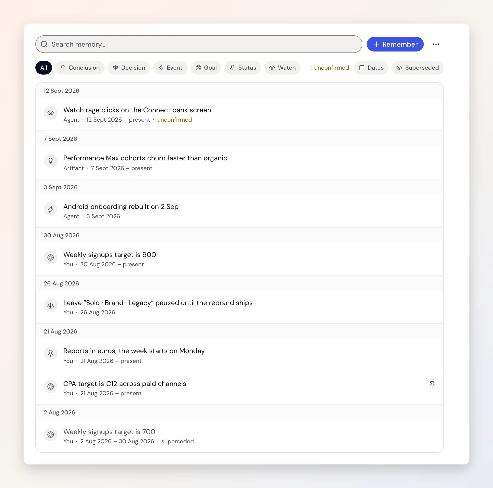
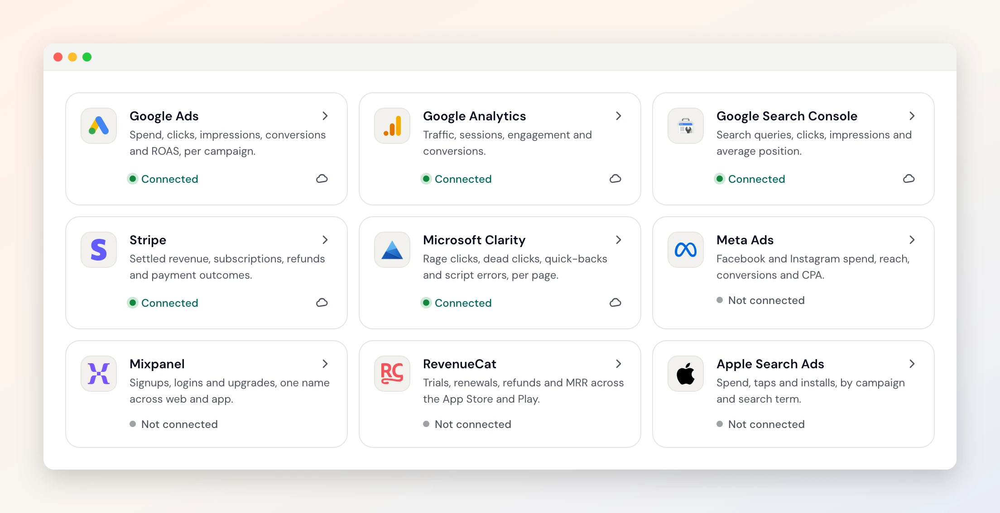
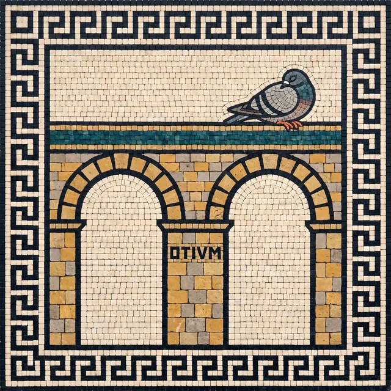

<p align="center">
  
</p>

# Duct

<p align="center"><a href="README.md">English</a> · <a href="README.es.md">Español</a> · <b>简体中文</b></p>

> 本文是机器翻译的初稿，尚待母语者校对。读到别扭的地方？欢迎直接提 PR，或在 [#537](https://github.com/5hirish/duct/issues/537) 里告诉我们：这是一个很好的第一个贡献。

**开源 AI 营销智能体：一个能登录你所有工具的增长分析师。**

Duct 为产品和增长团队而做。它连接 Google Ads、GA4、Search Console、Mixpanel、Stripe 以及另外七个工具，像一个握有所有账号的分析师那样同时读取所有数据，记住它对你的业务了解到的一切，并在你批准后替你修改这些工具里的设置。模型能调用的工具列表里根本没有“批准”这一项：按下按钮的是你。

[](LICENSE)
[](.github/workflows/backend.yml)
[](.github/workflows/app.yml)
[](https://getduct.ai/zh-cn/download)

**[⬇️ 下载桌面应用](https://getduct.ai/zh-cn/download)**，Duct 会替你运行服务，你的模型密钥始终留在你自己的电脑上。想自己运行每一个部分？[自行部署](#-自行部署)。代码相同，都是 MIT 许可。

公测期间免费 · 无需信用卡 · 大约 10 分钟连接好你的工具

| 安装之前 | 直接回答 |
|---|---|
| **我的密钥存在哪里？** | 模型密钥：存在你系统的钥匙串里，从不保存在我们的服务器上。工具连接：静态加密，每次只作用于一个项目；自行部署时就存在你自己的磁盘上。 |
| **没有我，智能体能做什么？** | 读取、比较、提出建议。默认情况下，在你按下“应用”之前，你账户里的任何东西都不会改变。[这是如何保证的](#-它会动手改你来批准)。 |
| **运行要花多少钱？** | 公测期间 Duct 免费。模型是你自己的：用你自己的 API 密钥，或在桌面应用里用你的 ChatGPT 订阅。 |
| **我能完全自己运行吗？** | 可以。[自行部署](#-自行部署)：SQLite 存在你的磁盘上，无需账户，数据不离开你的电脑。 |
| **如果 Duct 不再维护了怎么办？** | 它是 MIT 许可的。自行部署版本是同一套代码，不依赖我们任何东西。 |

---

## 🤖 三个智能体，更多正在路上

**📊 洞察（Insights）。** 问一句“上周注册量为什么下降了”，你会得到一个同时读取 Google Ads、GA4 和 Stripe 的答案，而不是一个一个分开看。它会发现这样的问题：*ROAS 上升了 14%，但 Android 的 7 日留存下降到了原来的 1/2.4。你在花钱获取会流失的用户。* 需要你做决定时，它会停下来问你；一个校验子智能体会在每个数字送到你面前之前重新核对一遍；它写的简报会被保存、留有版本，并注明数据来源。

**🌱 SEO 审计。** 粘贴一个网址，Duct 会抓取整个网站，读取技术和内容信号，然后交给你一份按优先级排好的报告。这是 [getduct.ai](https://getduct.ai/zh-cn/) 上免费的入口：无需账户就能运行一次。

**🎬 Content Studio。** 计划排在看板上，每张卡片一篇帖子，为每篇生成幻灯片和配图，一键发布到 TikTok、Instagram、LinkedIn、YouTube、Threads、X、Facebook、Pinterest 和 Bluesky。发布效果会回到卡片上，下一份计划会从上一份里学习。

<p align="center">
  
  
</p>

**目前适合谁：** 产品经理和增长团队、SEO 和内容团队，以及在追查归因缺口、预算调整和创意疲劳的效果营销人员。

**🚧 接下来：** 销售与营收运营（从 CRM、通话和产品使用数据中发现管线风险和转化信号）、电商与 DTC（跨 Meta Ads、Stripe 和 RevenueCat 找出 LTV 与 ROAS 之间的盲区），以及客户成功（从 NPS、使用情况和支持信号中找出有流失风险的账户）。进展请关注 [Issues](https://github.com/5hirish/duct/issues) 和 [getduct.ai](https://getduct.ai/zh-cn/)。

## 🔑 使用你的 ChatGPT 订阅

在桌面应用里用你自己的 ChatGPT 订阅登录，Duct 就在它上面运行。不需要 API 密钥，也没有第二份账单。或者带上 Anthropic、OpenAI、Gemini、xAI 或 OpenRouter 上任何模型的密钥，并分配三个档位：Heavy、Standard 和 Light，这样深度分析和简单摘要就不会付同样的价钱。遇到速率限制时，Duct 会降一档继续运行，而不是直接停下。

<p align="center">
  
</p>

## ✅ 它会动手改，你来批准

智能体可以提出一项变更并给你预览；由一个人来应用它。暂停广告系列、添加否定关键词、设置预算或出价、创建 GA4 关键事件或受众、发布 Tag Manager 版本、给 Mixpanel 添加注释。每个变更集都会先预览，对照你设置的防护规则检查，只在批准后才应用，并且可以回滚。智能体可以提出和查看，但不能批准或应用。这个决定写在模型永远看不到的代码里，并且有一个测试确保它一直如此。

<p align="center">
  
</p>

## 🧠 它会记住

Duct 会记住你的业务、你的项目以及它做过的工作：CPA 目标、你让它忽略的那个广告系列（以及是你说的），上个月简报里的发现。每条事实都知道它在什么时候成立、后来被什么取代，所以一个回答能说明它为什么这么认为。你可以查看完整的时间线，纠正它，置顶重要的内容，暂停或重置它。

<p align="center">
  
</p>

## 🔌 连接器，每个月都有新的

Google Ads · Google Analytics 4 · Search Console · Tag Manager · Meta Ads · Apple Search Ads · OpenAI Ads · Mixpanel · Microsoft Clarity · GrowthBook · Stripe · RevenueCat · GitHub，接下来是 HubSpot，智能体需要什么，新的连接器就会跟上。每个连接器能读取和修改什么：[getduct.ai/integrations](https://getduct.ai/zh-cn/integrations/)。

Google 通过 OAuth 连接，默认只读，除非你授予更多权限；其余工具粘贴一个密钥即可。凭据静态加密，每次只作用于一个项目，Duct 会明确告诉你它拥有哪些权限、还缺哪些。

<p align="center">
  
</p>

## 👥 为团队而建

项目承载上下文。邀请协作者，用链接和他们分享报告，每份简报、审计和计划都留在项目的资料库里，带有版本，留给下一个来问的人。

## 🖥️ 桌面应用

原生支持 macOS、Windows 和 Linux。模型密钥存在系统钥匙串里，登录在你自己的浏览器中完成，更新经过签名，启动时它会用一幅马赛克跟你打招呼。**[下载](https://getduct.ai/zh-cn/download)。**

### 🏠 自行部署

同一个应用可以连同后端一起构建：SQLite 存在你的磁盘上，只监听本机回环地址，无需账户，数据不离开你的电脑。也可以把后端运行在你自己的服务器上：

```bash
git clone https://github.com/5hirish/duct.git && cd duct
make setup
cp backend/.env.example backend/.env.local   # 添加一个模型服务商的密钥
make serve-backend                            # 然后在第二个终端里运行：
make serve-app
```

完整的环境搭建见 [CONTRIBUTING.md](CONTRIBUTING.md)，自行部署版本的构建见 [desktop/README.md](desktop/README.md)。

## 🧭 它是怎么构建的

后端是 Python 和 FastAPI，浏览器里是 Next.js，桌面端是 Tauri 外壳，全部在一个仓库里。**[docs/architecture.html](docs/architecture.html)** 是一张可交互的地图：在浏览器里打开它，选择你要做的事，它会带你找到对应的文件。[Duct Doctrine](https://getduct.ai/zh-cn/doctrine) 是这个项目所信奉原则的简短版本，每一条都链接到执行它的代码。

| 路径 | 内容 | 先读 |
|---|---|---|
| [`backend/`](backend/) | API、智能体、连接器、数据库 | [`backend/AGENTS.md`](backend/AGENTS.md) |
| [`app/`](app/) | 产品界面 | [`app/AGENTS.md`](app/AGENTS.md) |
| [`desktop/`](desktop/) | 原生外壳 | [`desktop/AGENTS.md`](desktop/AGENTS.md) |
| [`site/`](site/) | getduct.ai | [`site/AGENTS.md`](site/AGENTS.md) |
| [`docs/`](docs/) | 工程记录和参考资料 | [`docs/README.md`](docs/README.md) |

## 🤝 参与贡献

从 [CONTRIBUTING.md](CONTRIBUTING.md) 开始（英文）。不写代码？[CONTRIBUTOR-PLAYBOOK.md](CONTRIBUTOR-PLAYBOOK.md) 适合设计反馈、写作和产品提案。每位帮忙的人都会记在 [CONTRIBUTORS.md](CONTRIBUTORS.md) 里。欢迎由智能体编写的贡献；PR 模板会问哪里用了智能体，好让审阅者知道该看哪里。如果你的母语是中文，校对界面和网站的中文翻译就是很好的第一个贡献。安全问题请按 [SECURITY.md](SECURITY.md) 报告，不要发公开的 issue。

## 💬 社区

问题和想法请发到 [Discussions](https://github.com/5hirish/duct/discussions)，用中文也可以；bug 和提案请发到 [Issues](https://github.com/5hirish/duct/issues)。Duct 由 [Shirish Kadam](https://github.com/5hirish) 开发；更多内容见 [shirishkadam.com](https://shirishkadam.com)、[@5hirish](https://x.com/5hirish) 和 YouTube 上的 [Ship with AI](https://youtube.com/@5hirish)。

## 📄 许可证

MIT，见 [LICENSE](LICENSE)。[NOTICE](NOTICE) 列出了许可证不覆盖的内容：`docs/guides/` 下的第三方文档，以及商标。

## 🏛️ 为什么叫“Duct”？

这个名字来自拉丁语。*Ductus*：引导。它也藏在 *aquaeductus*（水道）这个词里。罗马的水道从来没有造出过一滴水。它们只是靠重力把水从水源送到人们居住的地方，其中一些两千年后的今天仍在运转，没有任何活动部件。这就是全部的工作描述。你的数据已经存在。Duct 就是那条水道。

这也是为什么应用用罗马门槛马赛克来迎接你，而不是机器人插画：前门是一个泉眼（`FONS`），开始时是一扇敞开的门（`SALVE`），还没有内容可看时是一个干涸的水池和两只好奇的鸽子（`NIHIL`），连接失败时是一座缺了一个拱的水道，你没有权限进入时是庞贝的看门狗（`CAVE·CANEM`），还有这一幅，留给一切都已处理完、水流正满的时候：

<p align="center">
  
  <br>
  <sub><em>OTIVM.</em> 闲暇。鸽子睡着了。你已经读到了 README 的结尾，也许你也该歇一歇了。</sub>
</p>
