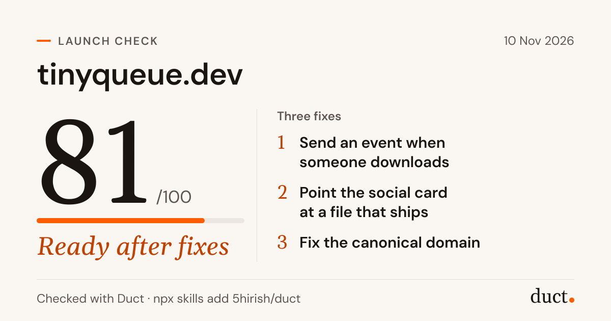

# getduct

Check your site before you launch it. One command reads your live pages,
scores the launch out of 100 and draws a card you can post.

```bash
npx getduct check yoursite.com
npx getduct card duct-launch-check.json
```



- **22 checks with fixed thresholds**: search, the social card, answer engines,
  analytics and the first screen. The same site gets the same score every time.
- **Reads 10 pages** plus robots.txt, the sitemap and llms.txt. About 80
  requests, 2 at a time, in 5 to 45 seconds.
- **No account, no key, no dependencies.** It sends nothing anywhere except
  the site it checks.
- **Unknowns cost nothing.** Some things the live site cannot show, like
  whether your signup sends an event. Those are marked unverified, never failed.

## It checks what a launch visitor hits first

| Area | Weight | A few of the checks |
|---|---:|---|
| Measurement | 25 | an analytics tag loads, on every page |
| Claims | 20 | left to your coding agent (below) |
| Search | 20 | indexable, titles, descriptions, canonicals, sitemap size, HTTPS, review markup |
| Social card | 15 | `og:image` loads, is 1200x630, has a large X card |
| Answer engines | 10 | GPTBot, ClaudeBot and PerplexityBot allowed, llms.txt, JSON-LD type |
| First impression | 10 | the main button works and names its outcome, no dead links |

Every check, with what makes it FAIL or WARN, is in the
[launch checklist](https://github.com/5hirish/duct/blob/main/skills/launch-check/references/checklist.md).

## The score is plain arithmetic

Each area starts at 100. A FAIL costs 25, a WARN costs 10, and an area never
drops below 0. The total weights the areas as above.

| Score | Band |
|---|---|
| 85 to 100 | Ready |
| 70 to 84 | Ready after fixes |
| 55 to 69 | Needs work |
| below 55 | Not ready |

The card recomputes the score from the checks in the file, so a card always
shows the number its findings add up to.

## Commands

| Command | Does |
|---|---|
| `getduct check <url>` | Checks the site, prints a summary, saves `duct-launch-check.json` |
| `--pages 10` | How many HTML pages to read, 1 to 25 |
| `--json` | Prints the result as JSON instead, and saves only with `--out` |
| `--out <file>` | Where to save the result |
| `getduct card <result.json>` | Draws the 1200x630 card as `duct-launch-check.png` |
| `--svg` | Draws an SVG instead |
| `--theme dark` | Warm charcoal instead of warm white |
| `getduct schema` | Prints the JSON Schema of a result |

Needs Node 20 or later. Requests identify themselves as
`getduct/<version> (+https://github.com/5hirish/duct)`.

## Your coding agent finds the rest

The live site cannot say whether your download button sends an event, whether
the card image ships with the build, or whether the homepage promises
something the code does not do. The launch-check skill reads your repository
for those, runs this CLI for the live part, and ranks the three fixes that
matter:

```bash
npx skills add 5hirish/duct
```

It works in Claude Code, Codex, Cursor and any agent that reads skills.

## Go deeper

- [Source](https://github.com/5hirish/duct/tree/main/cli) and
  [result schema](https://github.com/5hirish/duct/blob/main/cli/schema/launch-check.schema.json)
- The card's fonts are DM Sans and Gelasio, both under the SIL Open Font
  License 1.1, bundled as outlines in `src/card/fonts/` with their licences.
- MIT licensed. Part of [Duct](https://getduct.ai), the open-source AI
  marketing agent.
