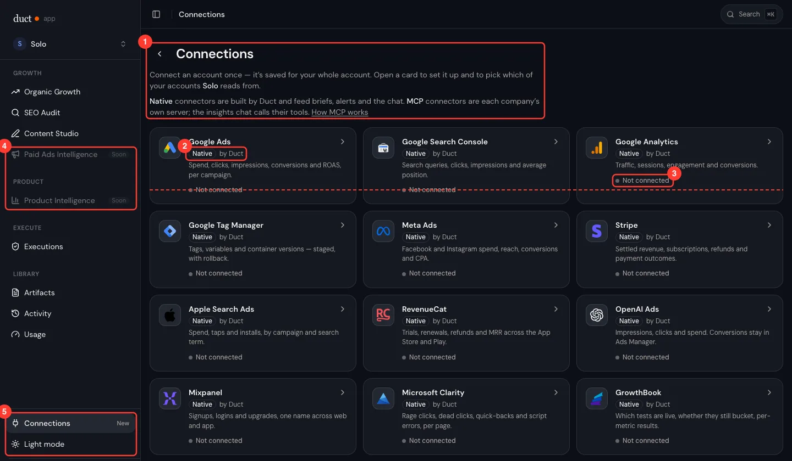
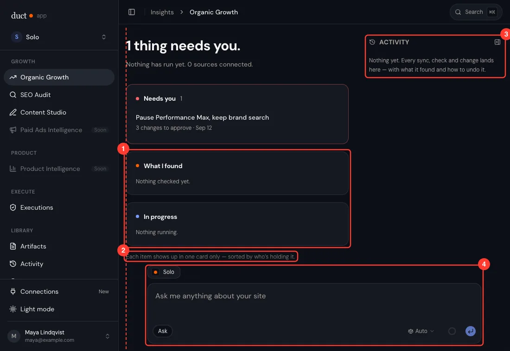
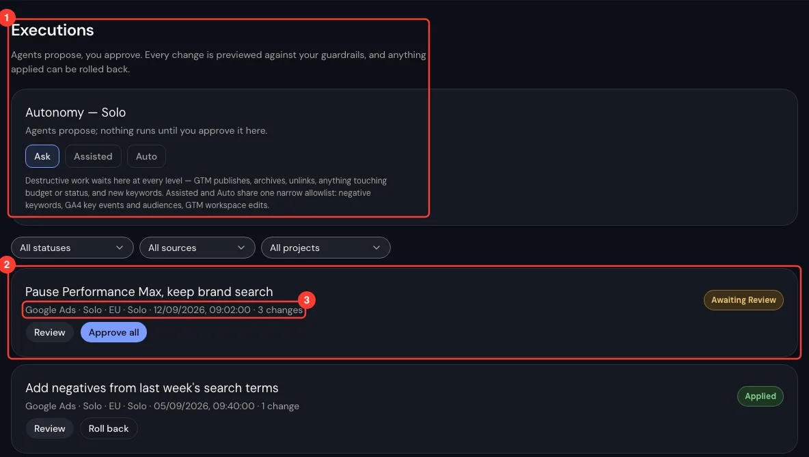
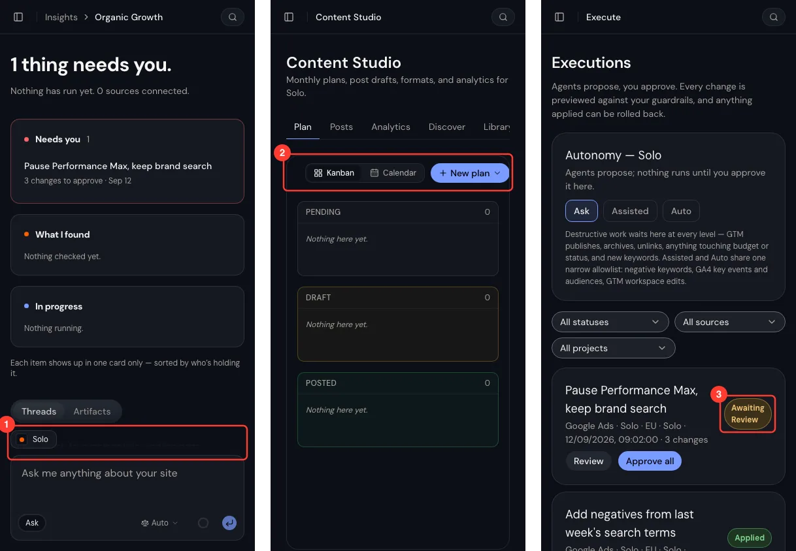
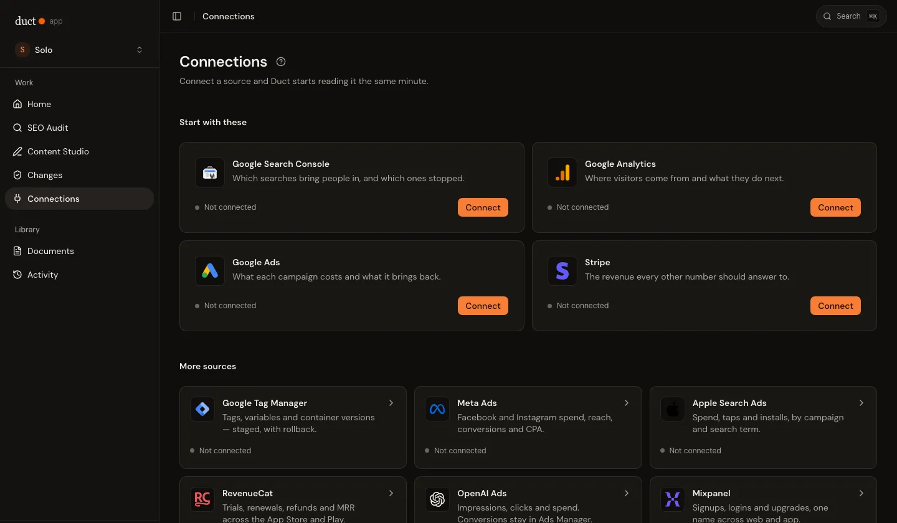
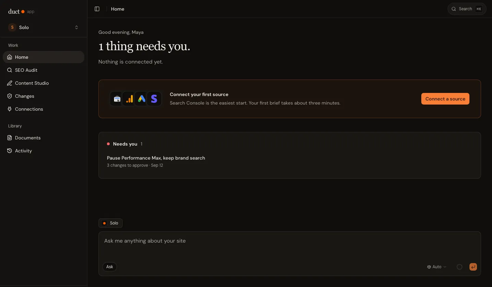

# Duct's UI is correct, cold, and explains itself

**Author:** Shirish Kadam · **Date:** 2026-11-02

**Bottom line:** every screen is hand-built with no shared frame, card or brand colour, so each one explains
itself in prose. Fix the system first, then rebuild the four screens people live in: answer first, teach only
when asked.

## At a glance

- **Page titles sit in 6 different places** across 16 screens, at 3 sizes and 3 weights. Two have none.
- **No screen uses the Card component.** There are 139 hand-styled bordered elements, 23 custom card classes and 8 tile widths.
- **53 words come before the first connector**, and 65 before the first change on Executions.
- **Brand orange appears once, in the logo dot.** Buttons are shadcn's default violet, a gap logged on 4 Sept and still open.
- **2 of 8 nav items say "Soon"**, while Connections sits in the footer next to "Light mode".

## Four causes, none of them a single screen

1. **No shared frame.** Each page builds its own header, container and grid, so fixing one never fixes the next.
2. **Cards hold text but don't line up.** Tile bodies are top-aligned, so status lines float. Grids auto-fill
   and leave orphans. The Desk's composer and rail sit outside the content column.
3. **The rules forbid, they never inspire.** `DESIGN.md` is 750 lines of mostly prohibitions, which yield
   correct, quiet, grey.
4. **Every fix adds a sentence,** in a comment and often on screen. Only the gaps a CI check enforced ever
   closed.

## The crimes, most-met first

| # | Crime | Where | Fix |
|---|---|---|---|
| 1 | **Title plus an essay** | 8 of 16 screens | Title and actions only |
| 2 | **The UI explains its own logic** | "Each item shows up in one card only…", a 36-word autonomy allowlist | Delete it, or hide it behind "?" |
| 3 | **Internal nouns** | Artifacts, Executions, "Native · by Duct", "Thought for 0s", `connect_bank` | The user's words: Reports, Changes |
| 4 | **Equal weight everywhere** | 15 identical tiles; 130px-tall rows for one line; boxes nested 3 deep | One hero per screen; lists as rows |
| 5 | **Badge confetti** | "Native" on 14 of 15 tiles | Label only the exception |
| 6 | **Empty states as furniture** | Desk, Content, Ask, Activity | Hide empty containers; one next step |
| 7 | **No shared frame** | 6 title positions; back arrows on top-level pages | One header and container |
| 8 | **Tiles don't line up** | Status lines step 17px across a row; orphan tile | Pin the card foot to the bottom |
| 9 | **Composer on the wrong column** | 216px off the content edge | Composer joins the content column |
| 10 | **Phone breakage** | Models 56px too wide; Content toolbar drops its week | Layout check at 390px in CI |
| 11 | **Everything is a pill** | Rounded inputs up to 1,150px wide | Rectangular fields at reading width |
| 12 | **Placeholders that lie** | Name field shows "Shirish" to everyone; SEO Audit suggests Duct's keywords | The user's data or a neutral example |
| 13 | **No brand** | Violet buttons, cold blue-grey dark theme | Primary to brand orange; warm neutrals |
| 14 | **Nothing celebrates** | A first connection or brief ends in silence; the error page is the most charming screen | Delight on rare wins |
| 15 | **Nav is the org chart** | Modules not jobs; a section holding only "Soon" | Home · Ask · Audit · Content · Changes · Library |

## What the best tools do instead

| Principle | Who does it | For Duct |
|---|---|---|
| **Answer first** | [ChatGPT Pulse](https://openai.com/index/introducing-chatgpt-pulse/) and [Linear Pulse](https://linear.app/changelog/2025-04-16-pulse) open on what changed | Home opens on the brief |
| **Teach when needed** | [Linear Integrations](https://linear.app/integrations): a title, no subtitle. [NN/g](https://www.nngroup.com/articles/empty-state-interface-design/): empty states give a path | No page descriptions |
| **Calm comes from hierarchy** | Linear's [2026 refresh](https://linear.app/now/behind-the-latest-design-refresh) dimmed the sidebar and warmed its greys | One hero per screen |
| **Essentials big, connect in context** | [Raycast Store](https://www.raycast.com/store) top picks; Claude suggests connectors mid-chat | Four sources up top; the agent asks |
| **Delight where use is rare** | [Family](https://benji.org/family-values), [Superhuman](https://blog.superhuman.com/game-design-not-gamification/), the [peak-end rule](https://www.nngroup.com/articles/peak-end-rule/) | Celebrate first wins |

## What we recommend: the system, then four screens

**The feeling:** a sharp colleague who did the homework. Warm, brief, glad when you win.

1. **Fix the frame first.** One page header, container and card on every screen, the brand orange as
   primary, and a CI layout check. This clears crimes 1, 4, 7–11 and 13.
2. **Rebuild four screens.** Home leads with one next step; Connections with four starters; Ask stays
   full-width chat until there is a report; Changes becomes rows.
3. **Add personality.** New nav, celebration moments, and one copy rule: explain nothing the user didn't
   ask about.

## How we got the numbers

Every route, signed in against the screenshot mock backend's invented company, at 1440, 1100 and 390px.
Measurements come from the rendered page; code counts are greps of `app/src`. Dialogs were not covered.

## Addendum, 2026-11-03: what shipped

All three steps landed, and four checks hold them (`app/DESIGN.md`, "The page
frame"). Correction: the phone composer "covering the threads" was a capture
artefact, so row 9 no longer claims it.

| Step | Shipped |
|---|---|
| Frame | `Page`, `PageHeader`, `Section`, `TileGrid`, `Card`, `Textarea` on all 17 framed screens; primary is the brand orange; warm neutrals; 8px radii |
| Screens | Home, Connections, Ask and Changes, rebuilt as recommended above |
| Personality | Nav by job, a first-connection celebration, an all-clear moment, the copy pass |
| Guards | `check:design` rules, `check-page-frame`, and `check:layout` in a browser as a CI job |

## Go deeper

- [`app/DESIGN.md`](../../app/DESIGN.md): the current rules and their Known gaps
- [`components/ui/page.jsx`](../../app/src/components/ui/page.jsx): the page frame
- [`scripts/check-layout.mjs`](../../app/scripts/check-layout.mjs): the browser check that holds it
